# Portfolio-OS

**A developer portfolio built as an operating system: a boot sequence, a file-system sidebar, a working shell, and case-study galleries for every project — no framework, no build step, no dependencies.**


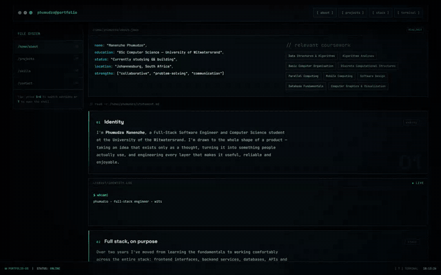

The site is three static files — `index.html`, `portfolio.css`, `portfolio.js` — served over any HTTP host. Everything below was captured from the site itself by a Playwright script, so the screenshots cannot drift away from the product.

---

## Table of contents

- [What is in it](#what-is-in-it)
- [Screens](#screens)
- [Project case studies](#project-case-studies)
- [Interaction model](#interaction-model)
- [Repository layout](#repository-layout)
- [Running locally](#running-locally)
- [Re-capturing the media](#re-capturing-the-media)
- [Deployment](#deployment)
- [Author](#author)

---

## What is in it

| Section | Purpose |
| --- | --- |
| **Boot sequence** | Types a BIOS log and animates a progress bar; any key or click skips it |
| **Welcome dialog** | One-line system message before entering, with a single explicit entry action |
| **Hero** | The pitch, the "DESIGN / ENGINEER / DELIVER" statement, and a system-core card with role, location, education and mode |
| **`/about`** | Profile as a read-only JSON document, then the story as four chapters — each separated by a live animation |
| **`/projects`** | Five project cards; each thumbnail opens a full case-study gallery |
| **`/stack`** | Language, web, backend, data and tooling proficiency read as config output |
| **`/contact`** | Email, GitHub, LinkedIn and phone as a connection panel |
| **Shell** | A real command loop: `help`, `about`, `projects`, `skills`, `contact`, `github`, `date`, `clear` |

The shell is not decoration — it reads the same project list the cards render, so the two cannot disagree.

The about story is deliberately paced: **01 Identity**, **02 Full stack on purpose**, **03 The problem is the point**, **04 Purpose, and what's next**. Between them sit five animations that only start when they scroll into view — a typing identity log, a request traced through `UI → API → SERVICE → DATA → INFRA`, an A\* search over a 15×7 grid, a git history with a feature branch merging back, and a career progress bar. They are drawn with CSS and a bit of JavaScript; there is no video and no library.

The layout is responsive. Under 700px the file-system panel is dropped — it would take half a phone screen to say what four links say better — and its destinations (`about`, `projects`, `skills`, `contact`) move into the top bar as a single row of equal buttons. The bar keeps the section links and nothing else: the window dots and the path are decoration and are dropped so the row stays one line tall instead of stacking to 70px.

---

## Screens

<table>
<tr>
<td width="50%">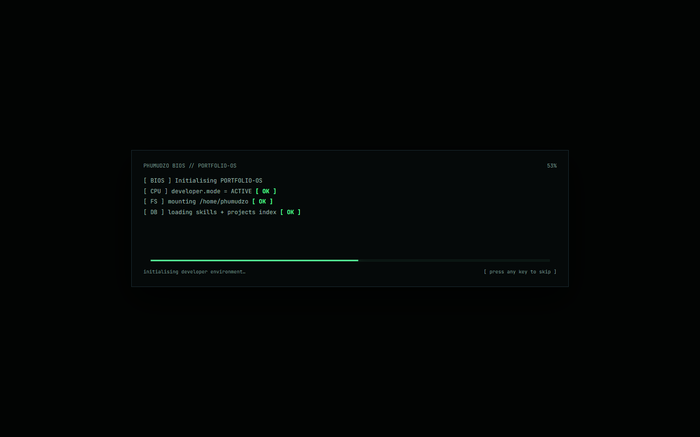<br/><sub><b>Boot</b> — a BIOS log and progress bar; any key skips it.</sub></td>
<td width="50%">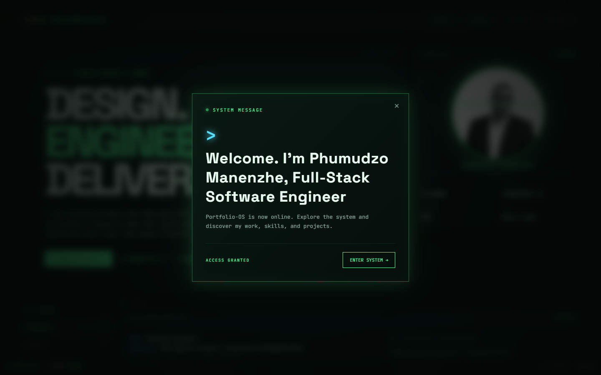<br/><sub><b>Welcome</b> — one system message, one way in.</sub></td>
</tr>
<tr>
<td width="50%">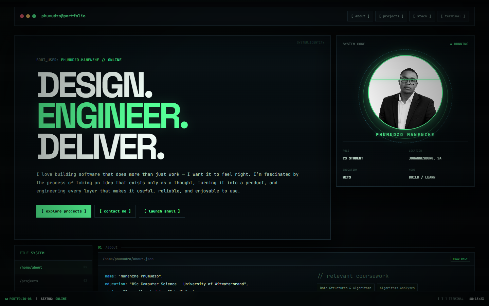<br/><sub><b>Hero</b> — the statement, the pitch, and the system-core card.</sub></td>
<td width="50%">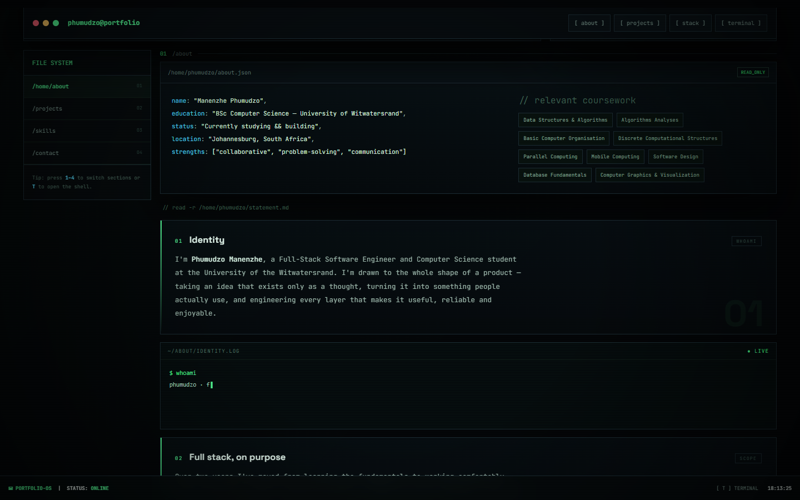<br/><sub><b>About</b> — profile as a read-only JSON document.</sub></td>
</tr>
<tr>
<td width="50%">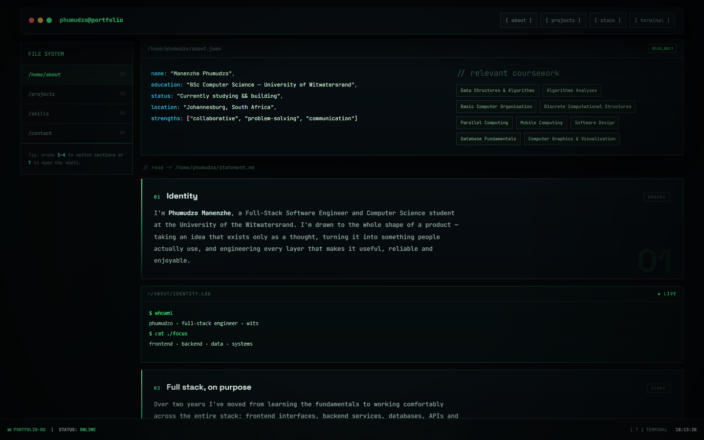<br/><sub><b>Story</b> — four chapters with a typed identity log between them.</sub></td>
<td width="50%">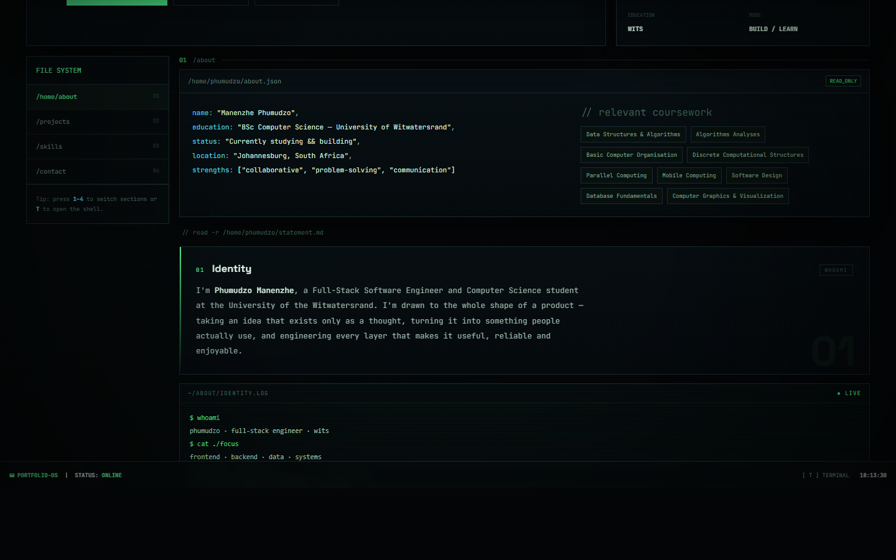<br/><sub><b>Animations</b> — a request traced UI → API → service → data → infra.</sub></td>
</tr>
<tr>
<td width="50%">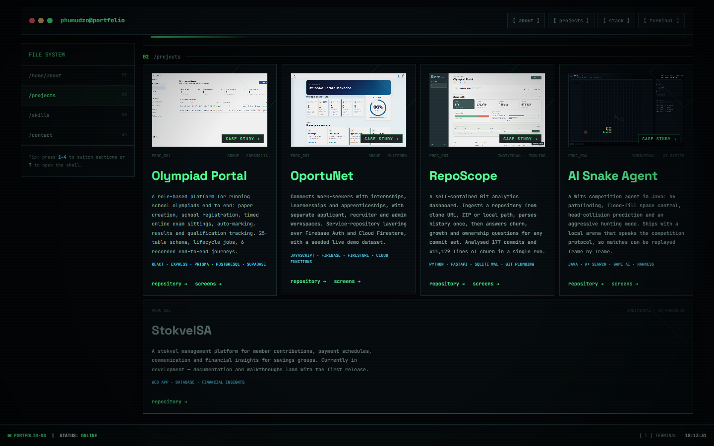<br/><sub><b>Projects</b> — five cards, each with a real screenshot from the running product.</sub></td>
<td width="50%">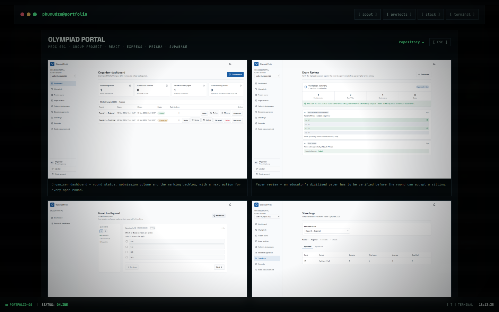<br/><sub><b>Case study</b> — the gallery opens over the page with captions and a link to the repository.</sub></td>
</tr>
<tr>
<td width="50%">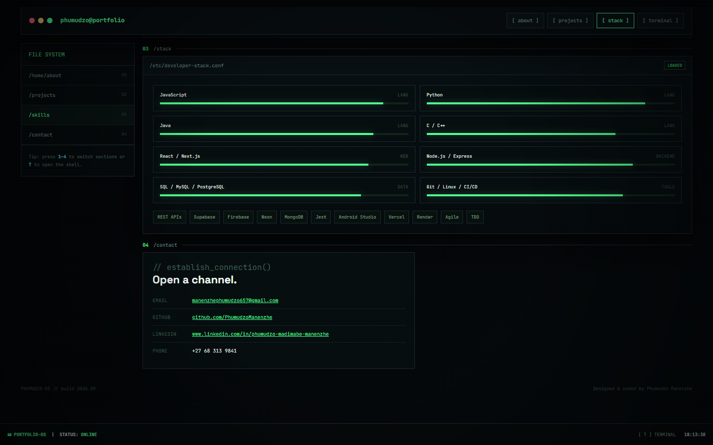<br/><sub><b>Stack</b> — proficiency bars and the contact panel in one frame.</sub></td>
<td width="50%">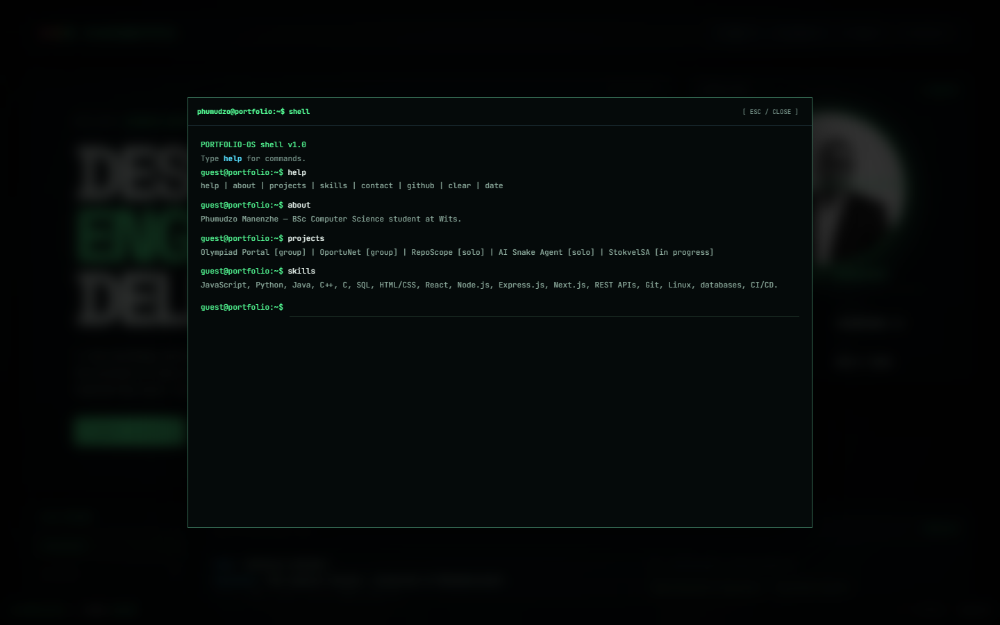<br/><sub><b>Shell</b> — the same project list the cards render.</sub></td>
</tr>
<tr>
<td colspan="2">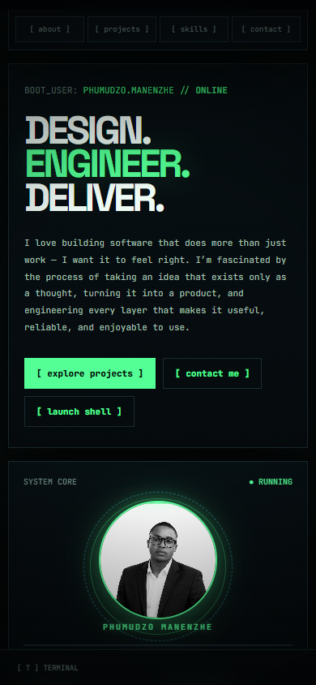<br/><sub><b>Phone</b> — the file-system panel gives way to four links in the top bar.</sub></td>
</tr>
</table>

**Recording:** [portfolio tour](assets/showcase/video/portfolio-tour.mp4) ([webm](assets/showcase/video/portfolio-tour.webm)) — boot, entry, the about chapters, the gallery, and the shell.

---

## Project case studies

Each card opens a gallery of screenshots captured from that project running for real, not montages. The galleries are defined in one place — `PROJECT_GALLERIES` in `portfolio.js` — so adding a project is a card in `index.html` plus an entry there.

| Card | Gallery | Source of the captures |
| --- | --- | --- |
| **Olympiad Portal** | 4 screens | Live PGlite + mock-Supabase harness, six recorded role journeys |
| **OportuNet** | 4 screens | Live Firebase project with a seeded demo dataset |
| **RepoScope** | 4 screens | Real ingestion of a 177-commit repository from a local path |
| **AI Snake Agent** | 3 screens | Match replay rendered from a trace the agent produced |
| **StokvelSA** | — | In progress; the card is explicit about it rather than showing placeholder work |

Every gallery image links to its full-resolution capture, so a reviewer can inspect a dashboard at 1600×1000 instead of trusting a thumbnail.

---

## Interaction model

| Input | Result |
| --- | --- |
| `1` `2` `3` `4` | Jump to About, Projects, Stack, Contact |
| `T` | Open the shell |
| `Esc` | Close the shell or the open gallery |
| Header nav button | Jump to a section, closing an open gallery or shell first |
| Click a card thumbnail, or **screens →** | Open that project's case-study gallery |
| Click outside the gallery frame | Close it |
| Any key / click during boot | Skip the rest of the boot sequence |

Two details that keep it coherent: while the shell or a gallery is open, numeric and `T` shortcuts are suppressed so typing does not scroll the page behind the overlay; and body scrolling is locked while a gallery is open, which is why the header nav buttons close the overlay first — otherwise the page behind them cannot scroll and the click looks dead.

---

## Repository layout

```
MyPortfolio/
├── index.html                  # markup: boot, welcome, hero, sections, shell, gallery
├── portfolio.css               # design system, layout, story animations, gallery styles
├── portfolio.js                # boot, shell, galleries, story animations, keyboard routing
├── profile.jpeg
└── assets/showcase/
    ├── screenshots/            # 10 desktop captures and 1 phone capture of this site
    ├── gif/portfolio-tour.gif  # 2.5 MB tour animation
    ├── video/                  # portfolio-tour.mp4 (2.1 MB) and .webm
    └── projects/
        ├── olympiad/           # 4 captures
        ├── oportunet/          # 4 captures
        ├── reposcope/          # 4 captures
        └── snake/              # 3 captures
```

---

## Running locally

There is nothing to install. Open `index.html` directly, or serve the folder if you want the same origin behaviour as production:

```bash
python -m http.server 5181
```

```bash
npx serve .
```

Then open <http://127.0.0.1:5181>.

---

## Re-capturing the media

The screenshots and the tour video come from a Playwright harness that is not shipped with this repository — it lives one directory up, in `_media-capture/`, and is shared with the other project documentation in this portfolio. It drives the site the way a visitor does — skipping boot, dismissing the welcome dialog, scrolling the about chapters, opening the Olympiad gallery, navigating to `/stack` *while that gallery is open*, and running four shell commands. It then reopens the page at 390×844 and asserts the phone layout: no sidebar, exactly four bar links, the name clear of the stats, and no horizontal overflow.

From that directory:

```bash
node portfolio.mjs           # 11 screenshots + portfolio-tour.webm
node gifs.mjs portfolio-tour # portfolio-tour.mp4 + portfolio-tour.gif
node check-galleries.mjs     # smoke test: all four galleries open, load, and close
```

The script fails the run instead of writing a misleading capture: it collects page errors and console errors, asserts the gallery frame is anchored exactly 86px below the viewport top, and asserts that a header nav click closes an open gallery. If you change the layout, re-run both — the captures are the source of truth for this README, so stale screenshots would be a bug.

---

## Deployment

The site is static, so any host works — GitHub Pages, Netlify, Vercel or plain object storage. Upload `index.html`, `portfolio.css`, `portfolio.js`, `profile.jpeg` and `assets/`. There are no environment variables, no API keys and no server-side code.

---

## Author

**Phumudzo Manenzhe** — BSc Computer Science, University of the Witwatersrand

- GitHub: [github.com/PhumudzoManenzhe](https://github.com/PhumudzoManenzhe)
- LinkedIn: [linkedin.com/in/phumudzo-madimabe-manenzhe](https://www.linkedin.com/in/phumudzo-madimabe-manenzhe)
- Email: manenzhephumudzo657@gmail.com
